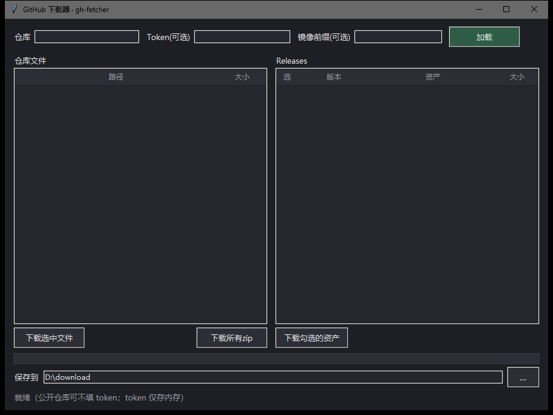

# gh-fetcher · GitHub 仓库/Release 下载器

一个深色 GUI 小工具：**输入仓库名，浏览文件树和 Releases，一键下载**。专为"直连 github.com 不稳"的环境设计——读取走 api.github.com，下载自动路由，绕开抖动链路。



## 它解决什么问题

直连 GitHub 下载 Release 资产时，流量要经过 `release-assets.githubusercontent.com`（CDN 段，国内经常抽风）——下载到一半断流、剩下一个打不开的半截文件。gh-fetcher 的做法：

- **读取**（文件树 / Releases 列表 / 源码文件）→ 全部走 **api.github.com**（实测全天最稳）
- **整仓 zip** → codeload.github.com
- **Release 资产** → 自动路由：自建/自定义镜像前缀（可选）→ 公共镜像链 → 直连重试
- **每条路由都校验字节数**，不符立即换下一条，绝不留半截文件冒充成功

## 使用

到 [Releases](https://github.com/Simiely/gh-fetcher/releases) 下载 `gh-fetcher.exe` 双击即用（零依赖，不需装 Python）。

1. 输入 `owner/repo`（如 `Simiely/MonitorBrightness`）或完整 GitHub 链接
2. Token 选填（公开仓库可不填；私有仓库必填）
3. 点「加载」→ 左侧文件树、右侧 Releases 列表
4. 左侧：选中文件 → 「下载选中文件」；或「下载所有zip」
5. 右侧：勾选资产 → 「下载勾选的资产」
6. 下载进度实时显示：**已下载/总量 · 速度 · 预计剩余时间**

### 设置说明

| 项 | 说明 |
|---|---|
| Token | 仅存内存，不落盘；**绝不发送给公共镜像**（私有仓库自动改走直连） |
| 镜像前缀(可选) | 自定义加速网关（任何 ghproxy 兼容服务），填了就优先走它 |
| 保存到 | 默认自动跟随系统下载目录（Known Folder API 自适应），可改 |

## 下载路由与安全

```
公开仓库资产： 镜像前缀(可选) → gh-proxy.com → ghproxy.net → 直连×2（带大小校验回退）
私有仓库资产： 直连 302（token 只发给 github.com，跨域重定向自动剥离）
```

镜像链上任何一条失败（限流 403 / 断流 / 大小不符）都会自动换下一条；整链失败 30 秒后自动重试一轮。

## 从源码构建

```bash
pip install pyinstaller
pyinstaller --onefile --noconsole --name gh-fetcher gh-fetcher.py
```

需要 Python 3.10+（含 tkinter）。架构与踩坑记录见 [DEVELOPMENT.md](DEVELOPMENT.md)。

## 文档

- [AGENTS.md](AGENTS.md) —— 项目规则（技术栈 / 关键坑 / 约定）
- [DEVELOPMENT.md](DEVELOPMENT.md) —— 架构说明与关键问题记录
- [CHANGELOG.md](CHANGELOG.md) —— 版本历史

## License

MIT
